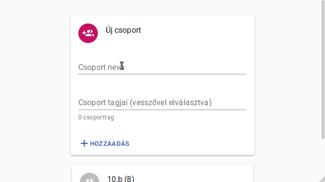

# Vocactive
Webapp for educators for increased student engagement. Created using React and MaterialUI


It's very important that educators keep all students engaged during the class. This app can manage groups of students, and help the teacher call them in random order - making sure that everyone can participate in the class. 

Usable on smartphones, tablets, laptops, smartboards. The data of the groups are saved locally, they never leave the device.

Offline (PWA) capabilities coming soon :)

## Drawing modes
When starting a session you can choose how names are drawn:
- **Teljesen véletlenszerű (totally random)** – every draw is independent, so the same student may come up several times in a row.
- **Egy pakli (one deck)** – every student is drawn exactly once before the deck is reshuffled.
- **Dupla pakli (double deck)** – as if each student's name were on two cards: everyone is drawn exactly twice before the deck is reshuffled, but never twice in a row.

## Display styles
Independently of the drawing mode, you can pick how the name is revealed:
- **Klasszikus (classic)** – a huge name on a full-screen color, instantly.
- **Szerencsekerék (wheel of fortune)** – every student is a slice; the wheel spins, ticks and slowly stops.
- **Nyerőgép (slot machine)** – a casino reel with blinking bulbs and a lever, stopping on the pay line.
- **Reflektor (spotlight)** – names on a dark stage; a spotlight hops from name to name, then the chosen one steps to center stage.
- **Reptéri tábla (departure board)** – a clattering split-flap board that spells out the name letter by letter.
- **Lufipukkasztás (balloon pop)** – every name is a balloon; they pop one by one and the last one left answers.

Click/tap or press Space/Enter for the next draw. Sounds are synthesized in the browser and can be muted from the toolbar.

## Development
Built with React, MUI and Vite. Requires Node.js 22.22 or newer.

```sh
npm install
npm run dev      # start the dev server
npm run build    # production build into dist/
npm run lint     # run ESLint
```

## Contribution
You are welcome to open issues or even pull requests. I'm looking forward to getting feedback from educators.


## Try it
[https://vocactive.netlify.com](https://vocactive.netlify.com)
